<div align="center">
  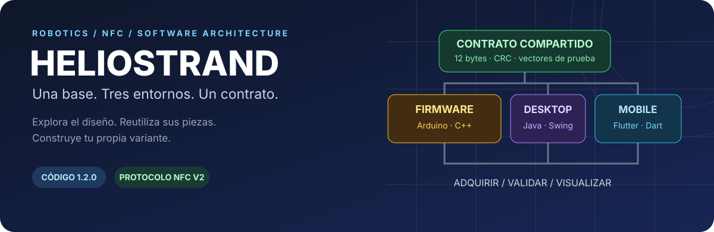
  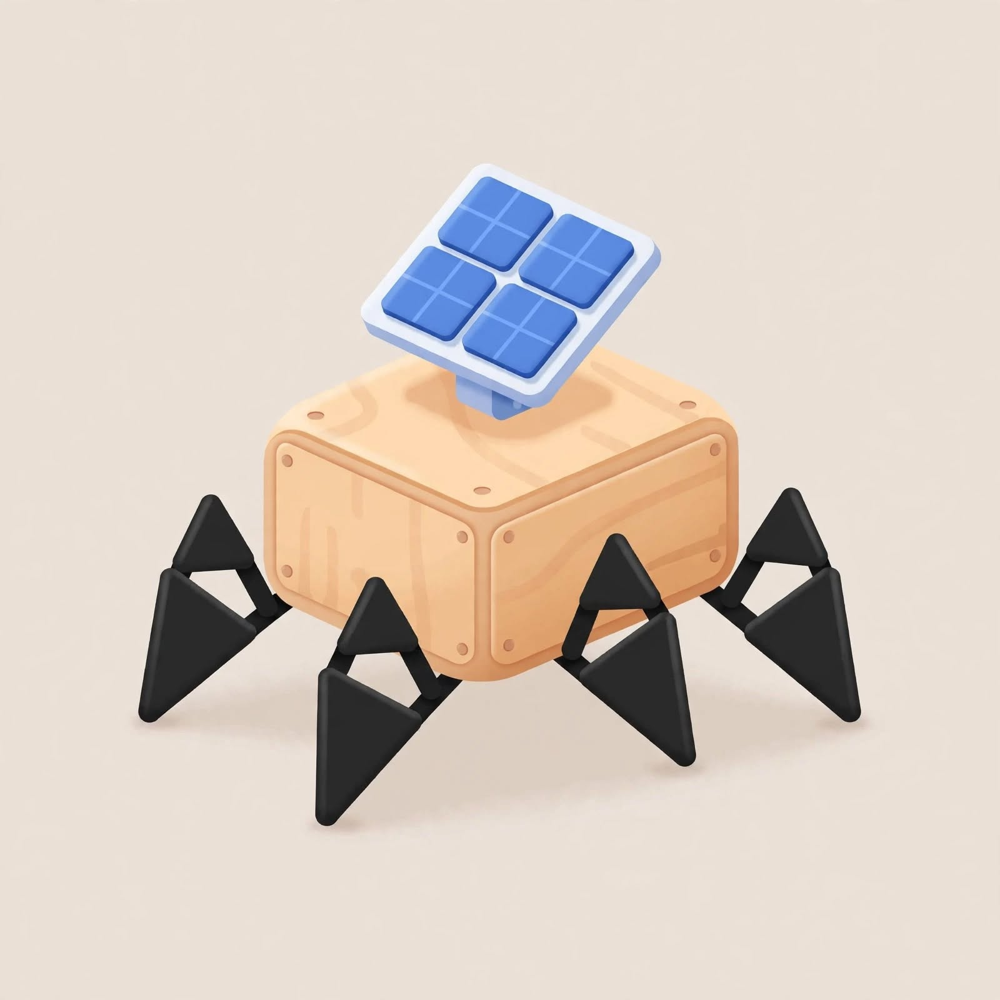
  <h1>Heliostrand · Solar Tracker</h1>
  <p><strong>Seguimiento solar biaxial, robótica Theo Jansen y telemetría NFC.</strong></p>
  <p>Arduino Uno · Java 21 · Flutter · Protocolo V2</p>

[](https://github.com/RamsesCB/heliostrand-nfc-core-cpp/actions/workflows/ci.yml)
[](#versiones)
[](#desktop-java)
[](#mobile-flutter)
[](#firmware-y-hardware)
[](#contrato-de-datos)
[](LICENSE.md)

</div>

---

## Navegación

| Explorar | Comprender | Adaptar y distribuir |
|---|---|---|
| [Visión general](#visión-general) | [Arquitectura](#arquitectura) | [Guía de adaptación](#guía-de-adaptación) |
| [Mapa conceptual](#mapa-conceptual) | [Desktop Java](#desktop-java) | [Desarrollo y validación](#desarrollo-y-validación) |
| [Tecnologías y decisiones](#tecnologías-y-decisiones) | [Mobile Flutter](#mobile-flutter) | [Distribución](#distribución-y-tamaño) |
| [Catálogo documental](#catálogo-documental) | [Firmware y hardware](#firmware-y-hardware) | [Versiones](#versiones) |
| [Mapa del repositorio](#mapa-del-repositorio) | [Contrato de datos](#contrato-de-datos) | [Contribuir](#contribuir) |

## Visión general

Heliostrand conecta un robot con seguimiento solar de dos ejes a clientes que permiten consultar sus sensores, servos, motor y batería. El firmware produce telemetría binaria; un tag pasivo **NTAG213** permite intercambiarla con un teléfono o un lector de escritorio.

| Componente | Responsabilidad | Tecnologías |
|---|---|---|
| Firmware | Muestreo LDR y batería, seguimiento solar, motor, persistencia NFC | Arduino Uno / ATmega328P, PlatformIO, PN532 SPI |
| Aplicación móvil | Dashboard, comandos de servos, historial y exportación JSON/CSV | Flutter, Dart, `flutter_nfc_kit` |
| Escritorio | Lectura NFC, gráficas, simulación y exportación JSON | Java 21, Swing/FlatLaf, JFreeChart, PC/SC |
| Contratos | Verificación común de serialización y validación | Vectores JSON, Unity, JUnit, Flutter Test |

El dashboard móvil conserva su diseño claro, tipografía Inter y acentos ámbar/celeste. Android es la plataforma móvil validada por CI. iOS declara el permiso de uso NFC y el entitlement `TAG`; necesita una firma/provisioning con esa capacidad para probarse en dispositivo. Los directorios iOS, macOS, Linux, Windows y Web son bases de plataforma; su presencia no implica una release NFC validada para cada sistema.

### Una base para construir sobre ella

Reutiliza el parser, las pruebas de contrato, el dashboard y los servicios existentes para concentrarte en tu robot. No se necesita un backend para leer el tag, simular o exportar datos. El historial es local y permanece en memoria hasta exportarse; no hay sincronización de cuentas ni base de datos remota.

| Quiero empezar por… | Ruta recomendada | Resultado |
|---|---|---|
| Ver la interfaz sin hardware | Ejecutar Java o Flutter y activar simulación | Explorar sensores, gráficas y reportes |
| Conectar el robot existente | [Pinout](docs/hardware/pinout.md), firmware y tag NTAG213 | Telemetría validada de extremo a extremo |
| Crear mi propia variante | [Guía de adaptación](#guía-de-adaptación) | Cambios localizados con contratos y pruebas reutilizables |
| Entender el diseño | Diagramas de [Java](#desktop-java), [Flutter](#mobile-flutter) y [firmware](#firmware-y-hardware) | Saber dónde vive cada responsabilidad |

> [!NOTE]
> El código está disponible para estudiar y adaptar según [HELS-AEL 1.0](LICENSE.md), con atribución obligatoria. «Source-available» no equivale a una licencia open source aprobada por la OSI. Revisa sus condiciones antes de redistribuir una variante.

## Mapa conceptual

Los colores distinguen responsabilidades: **ámbar = robot**, **azul = móvil**, **violeta = escritorio**, **verde = contratos y calidad**. Los textos y las relaciones también identifican cada área, sin depender solo del color.

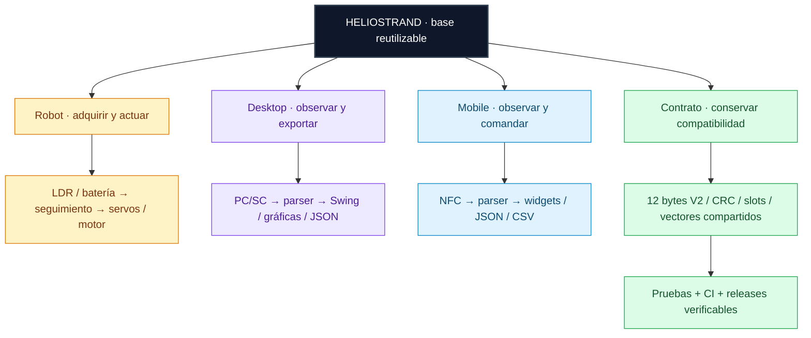

## Tecnologías y decisiones

Esta sección explica el encaje técnico de las tecnologías **presentes en el código**, sus límites y los puntos de sustitución. No pretende reconstruir decisiones históricas que no estén documentadas ni presentar una comparación exhaustiva de alternativas.

| Tecnología actual | Qué aporta a esta base | Límite o coste | Cómo sustituirla |
|---|---|---|---|
| Arduino Uno / C++ / PlatformIO | Control directo de GPIO, ADC, PWM y compilación reproducible | Memoria reducida y medición ADC ligada al AVR | Portar placa y lectura de batería; conservar serialización y pruebas |
| PN532 SPI + NTAG213 | Intercambio de snapshots sin emparejamiento ni servidor | El tag conserva la última escritura; no es telemetría en vivo continua | Adaptar `NfcTransceiver` y los lectores si cambian comandos, CC o páginas |
| `Servo` + `Adafruit PN532` | Acceso al hardware desde dos bibliotecas fijadas en PlatformIO | Sus temporizadores y buses condicionan la placa | Cambiar el adaptador hardware, comprobar temporizadores y pines |
| Java 21 + Swing | Cliente de escritorio con eventos y widgets del JDK | El EDT no debe ejecutar operaciones lentas | Conservar dominio/parser; reemplazar vista y controlador al migrar toolkit |
| FlatLaf + JFreeChart | Apariencia homogénea y gráficas Swing | La composición está en `MainTrackerFrame` | Sustituir tema en `Main` y construcción de gráficas en la ventana |
| `javax.smartcardio` / PC/SC | Acceso al lector y APDU desde Java | Requiere driver/servicio PC/SC y lector compatible | Sustituir servicio conservando callbacks `NfcEventListener` |
| Gson | Exportación JSON del historial Java | El esquema público del reporte debe mantenerse | Cambiar el serializador en la exportación y comparar JSON |
| Flutter / Dart / Material | UI móvil por widgets y lógica compartida de presentación | Los plugins tienen capacidades distintas por plataforma | Mantener modelos/parser y adaptar servicios nativos por plataforma |
| `flutter_nfc_kit` | Polling y transceive Type 2 usados por `NfcService` | Disponibilidad de NFC y ciclo de sesión del sistema | Encapsular otro plugin dentro del servicio, conservar streams y ACK |
| Streams + `setState` | Comunicación asíncrona y estado local sin framework adicional | El dashboard posee servicios y suscripciones | Introducir inyección al necesitar múltiples implementaciones; no existe un contenedor DI actual |
| `path_provider` + `share_plus` | Guardar y compartir reportes usando el sistema | Rutas y diálogo de compartir dependen del SO | Reemplazar salidas de `ReportService`, conservar generadores JSON/CSV |
| `intl` + `google_fonts` | Formato de fechas y tipografía Inter del tema | Fuentes y formato son decisiones de presentación | Cambiar widgets/tema; verificar fuentes disponibles y capturas |
| `package_info_plus` + `shared_preferences` | Leer build number y recordar política de versión | La caché no es una base de datos de telemetría | Reemplazar almacenamiento de política manteniendo entero y fallback |
| `url_launcher` + Sentry | Enlaces externos y reporte de errores opcional | Red/configuración externa cuando se utilizan | Centralizar enlaces en `ui/actions.dart`; configurar o desactivar Sentry |
| Unity + JUnit + Flutter Test | El mismo contrato se verifica en tres lenguajes | Los dobles de hardware no certifican el circuito físico | Añadir regresiones junto a los vectores y pruebas de transporte |
| Maven Wrapper + GitHub Actions | Construcción Java y validación del monorepositorio | CI depende de toolchains y credenciales de release | Mantener comandos locales equivalentes y validar versiones de tags |

Las versiones exactas se consultan en [PlatformIO](platformio.ini), [Maven](AplicacionJava/pom.xml), [pubspec](heliostrand_app/pubspec.yaml) y su [lockfile](heliostrand_app/pubspec.lock). Las configuraciones de referencia están fijadas en [CI](.github/workflows/ci.yml).

## Arquitectura

### 1. Ecosistema y transportes

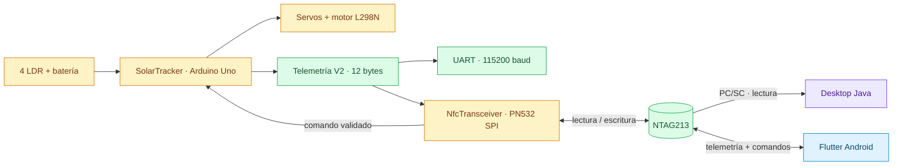

El PN532 es lector/escritor del tag. Los clientes leen el **NTAG213**, no directamente el PN532. UART es un transporte binario independiente; no existe un lector UART en el cliente Java actual.

### 2. Capas de las aplicaciones

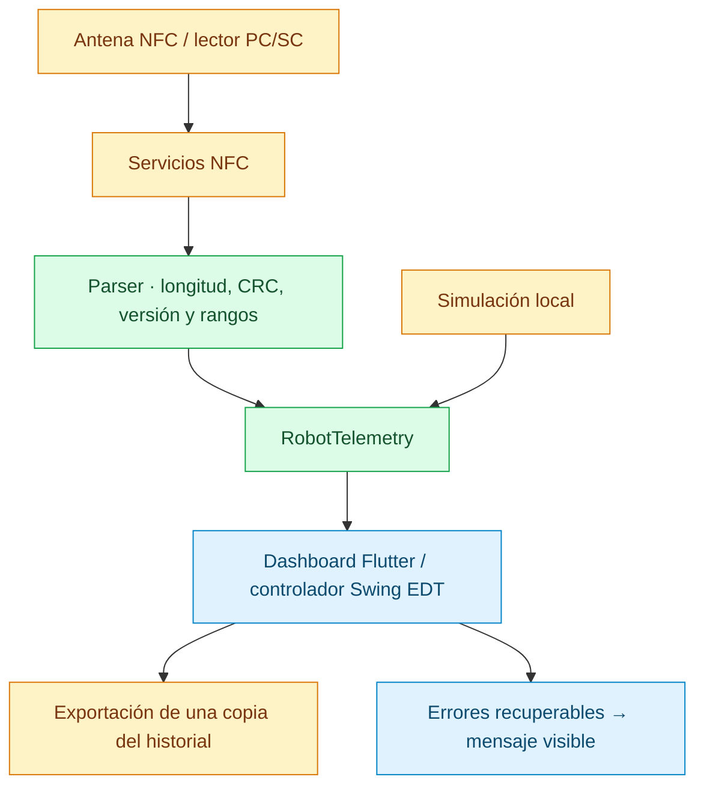

- **Dominio y parser:** el mismo frame produce los mismos valores en C++, Java y Dart. El parser no depende de widgets.
- **Servicios:** NFC, simulación, exportación y política de versiones tienen responsabilidades separadas. Las sesiones NFC no se duplican al pulsar repetidamente.
- **Presentación:** Flutter consume streams; Java entrega eventos al EDT. La inicialización PC/SC y la escritura de reportes Java se ejecutan fuera de ese hilo.
- **Resiliencia:** errores de exportación, enlaces y lecturas se comunican al usuario. El historial mantiene hasta 500 muestras; el móvil muestra primero las cinco más recientes.

### 3. Comandos separados de la política de escritura

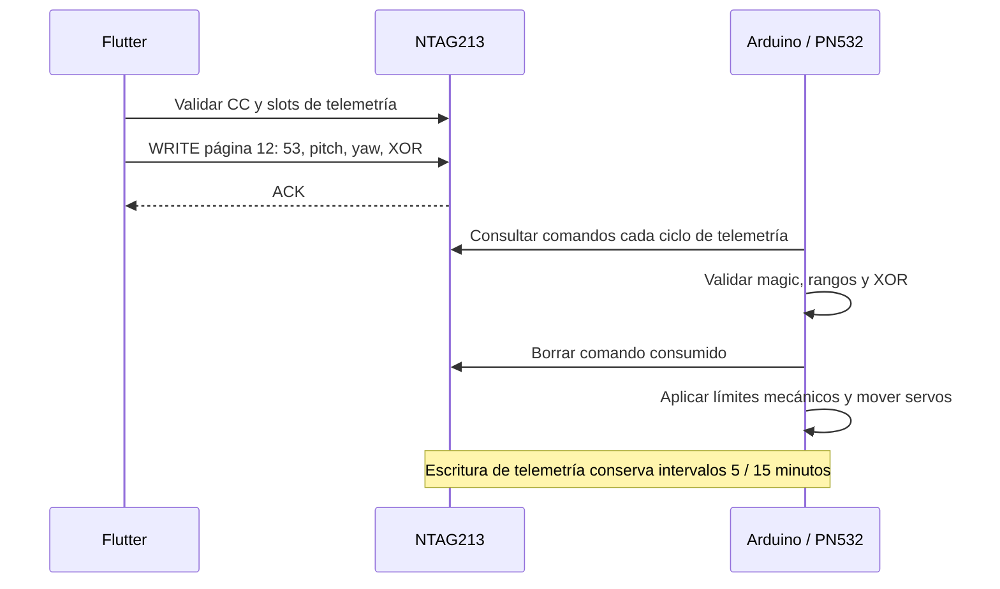

La consulta de comandos se realiza cada segundo cuando hay hardware disponible; no espera a la siguiente escritura de telemetría. El acuse de borrado debe tener éxito antes de entregar el comando. Un error de escritura conserva el comando móvil para reintento. La consigna ajusta los ángulos y el seguimiento automático continúa; no cambia a un modo manual persistente.

### 4. Despliegue y límites del sistema

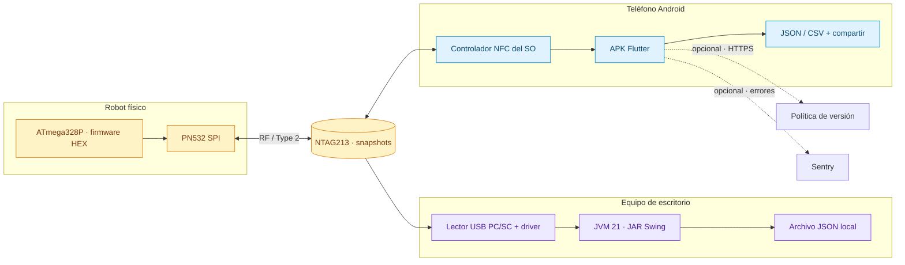

No hay servidor de aplicación ni despliegue Heroku definido. Los APK se instalan en dispositivos, el JAR se ejecuta con JVM y el HEX se carga en la placa. El teléfono y el PN532 acceden al tag por turnos; el diagrama expresa canales lógicos, no acceso RF simultáneo garantizado.

## Desktop Java

### Clases y responsabilidades

Vista resumida de las clases reales; se omiten campos y métodos secundarios. `Main` conecta la ventana, el controlador y el servicio. La simulación, el historial y la exportación todavía están en la ventana: no se presentan como capas independientes inexistentes.

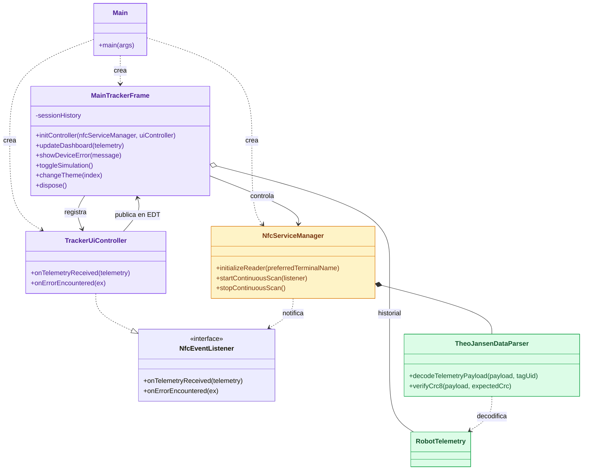

| Pieza | Dónde empezar | Regla de extensión |
|---|---|---|
| Arranque y tema | [Main.java](AplicacionJava/src/main/java/com/ramsescb/heliostrand/desktop/Main.java) | Crear componentes y abrir ventana en EDT |
| Ventana, gráficas e historial | [MainTrackerFrame.java](AplicacionJava/src/main/java/com/ramsescb/heliostrand/desktop/MainTrackerFrame.java) | Mantener actualizaciones Swing en EDT; archivos/lector en workers |
| Adaptador de eventos | [TrackerUiController.java](AplicacionJava/src/main/java/com/ramsescb/heliostrand/desktop/ui/controller/TrackerUiController.java) | Traducir callbacks a actualizaciones de vista |
| Lectura PC/SC | [NfcServiceManager.java](AplicacionJava/src/main/java/com/theojansen/nfc/core/NfcServiceManager.java) | Liberar tarjetas, cancelar sesiones y conservar fallback entre slots |
| Dominio y contrato | [Modelo](AplicacionJava/src/main/java/com/theojansen/nfc/model/RobotTelemetry.java) · [parser](AplicacionJava/src/main/java/com/theojansen/nfc/parser/TheoJansenDataParser.java) | Conservar validación y compatibilidad de reportes |

### Casos de uso de escritorio

Representación de casos de uso con actores y límite de aplicación mediante Mermaid. Las relaciones punteadas indican validación interna necesaria, no acciones adicionales del usuario.

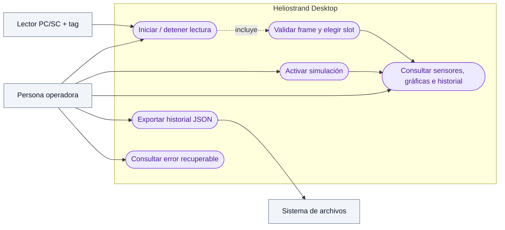

El escritorio actual **no escribe comandos de servos NFC** ni exporta CSV. Para añadirlo hay que implementar esa capacidad, sus controles y sus pruebas; no basta con cambiar una opción de configuración.

### Lectura sin bloquear la interfaz

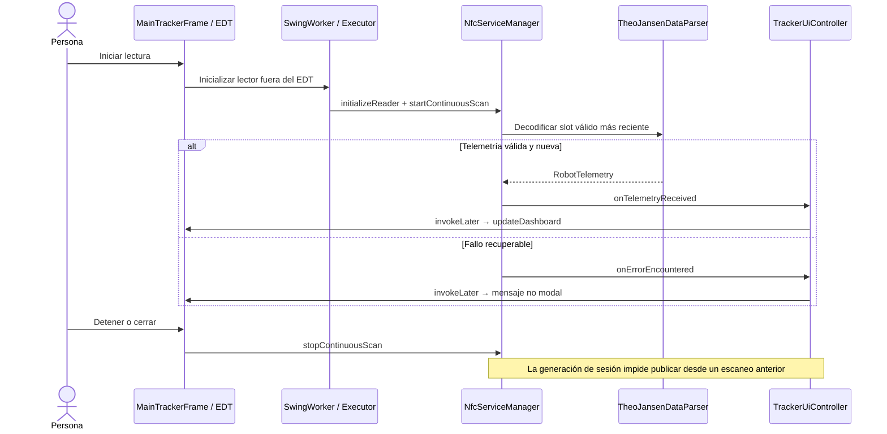

## Mobile Flutter

### Clases, servicios y widgets

El estado privado `_DashboardScreenState` posee los servicios y suscripciones; `DashboardScreen` es su widget público. Los nombres del diagrama corresponden al código actual, no a una arquitectura futura con repositorios o gestores de estado adicionales.

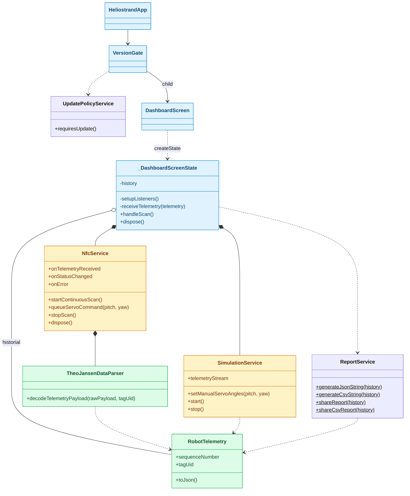

| Área | Archivos | Qué reutilizar |
|---|---|---|
| Entrada y política de versión | [main.dart](heliostrand_app/lib/main.dart) · [VersionGate](heliostrand_app/lib/ui/screens/version_gate.dart) · [UpdatePolicyService](heliostrand_app/lib/services/update_policy_service.dart) | Inicio, bloqueo por build number y caché de política |
| Composición de pantalla | [DashboardScreen](heliostrand_app/lib/ui/screens/dashboard_screen.dart) | Selección de fuente, estado, suscripciones e historial |
| Componentes visuales | [Widgets](heliostrand_app/lib/ui/widgets) · [tema](heliostrand_app/lib/ui/theme.dart) | Tarjetas LDR, servos, batería/motor e historial |
| Transporte y simulación | [NfcService](heliostrand_app/lib/services/nfc_service.dart) · [SimulationService](heliostrand_app/lib/services/simulation_service.dart) | Streams de telemetría y lifecycle |
| Contrato | [Parser](heliostrand_app/lib/parser/theo_jansen_data_parser.dart) · [modelo](heliostrand_app/lib/models/robot_telemetry.dart) | Validaciones y representación de datos |
| Reportes y errores UI | [ReportService](heliostrand_app/lib/services/report_service.dart) · [actions.dart](heliostrand_app/lib/ui/actions.dart) | Serializar, compartir y mostrar errores con `SnackBar` |

Los atributos privados del diagrama se abrevian para facilitar la lectura; en Dart los identificadores reales llevan `_`, como `_history` y `_receiveTelemetry`.

### Casos de uso móviles

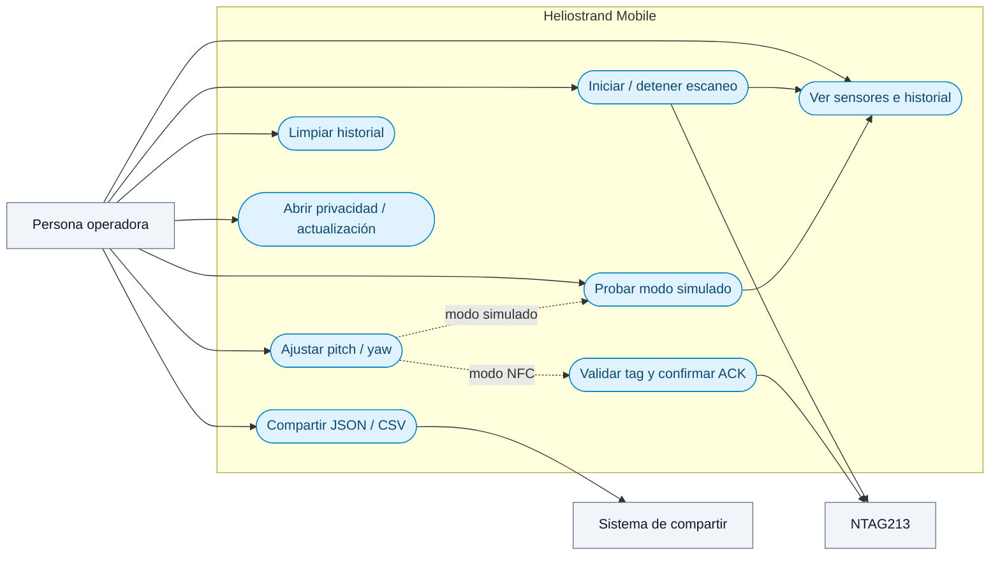

### Actividad: una lectura válida o un error recuperable

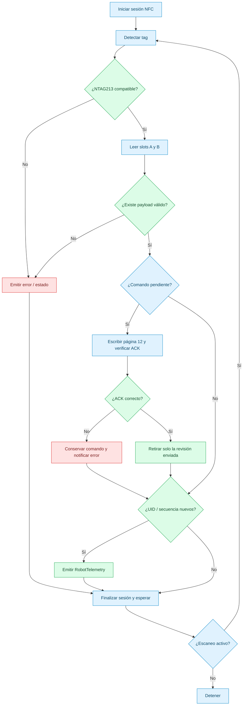

El flujo resume la lógica de `NfcService`: se comprueba el ciclo de vida en puntos críticos después de operaciones asíncronas. Detener el escaneo espera a su tarea antes de cerrar los streams. Un ACK confirma la escritura del tag; **no confirma por sí solo que el robot haya movido el servo**.

## Firmware y hardware

### Clases y puntos de extensión

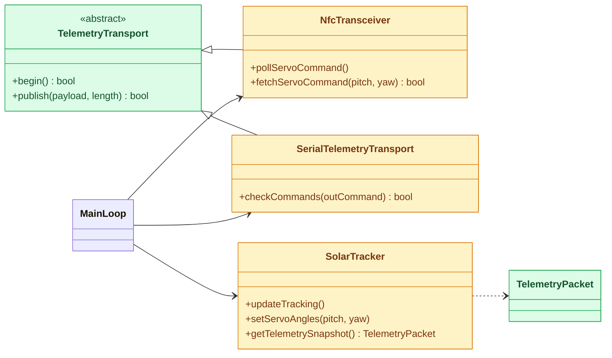

`MainLoop` es una agrupación conceptual que representa las funciones `setup()`/`loop()` de [src/main.cpp](src/main.cpp), **no una clase C++**. El punto de extensión real es [TelemetryTransport](include/TelemetryTransport.h). El controlador entrega un `TelemetryPacket`; `packTelemetry` produce el buffer V2 usado por los transportes. El bucle actual conecta instancias concretas de NFC y serial.

### Por qué estos componentes y qué implica cambiarlos

| Componente | Encaje en el diseño | Sustitución y comprobaciones necesarias |
|---|---|---|
| 4 LDR | Comparación norte/sur y este/oeste para orientar dos ejes | Cambiar adquisición en `SolarTracker`; mantener orden y cuantización 0–255 o versionar el protocolo |
| Dos servos | Posición angular directa por eje | Ajustar mínimos/máximos, reposo y paso; verificar alimentación, rango mecánico y temporizadores |
| Motor DC + L298N | Dos señales de dirección y una de habilitación | Adaptar tabla de estados/PWM para otro puente H; comprobar tensiones, corriente y estado detenido |
| Arduino Uno | Implementación AVR compacta y pines definidos | Para ESP32 u otra placa, portar ADC/referencia, pines y buses; cambiar solo `board` no es suficiente |
| PN532 en SPI | Biblioteca existente y transporte aislado del seguimiento | I²C/UART u otro lector requieren adaptar constructor, inicialización y operaciones de tag |
| NTAG213 | Páginas de 4 bytes y capacidad suficiente para dos slots y comando | Otro tag exige revisar CC, comandos, páginas reservadas y los lectores Java/Flutter |
| Li-ion 1S + divisor resistivo | Medición de batería con validación y estado N/D | Otra química/tensión exige redimensionar divisor y cambiar rangos en firmware, parsers, simuladores y vectores |

El seguimiento se evalúa cada **250 ms**; UART y consulta de comandos NFC, cada **1 s**. El contenido de telemetría del tag se actualiza con la política **5/15 min**: las aplicaciones pueden mostrar una instantánea anterior, aunque el robot siga moviéndose.

## Contrato de datos

| Canal | Formato | Validación |
|---|---|---|
| Telemetría | 12 bytes; batería `uint16` Big-Endian | V2, rangos físicos, CRC-8 `0x07`, inicial `0x00` |
| UART | `AA 55` + 12 bytes + `CR LF` | Flujo de máquina sin logs de texto |
| Slot A | Páginas 4–6 + commit en 7 | Magic `48 53`, generación y complemento |
| Slot B | Páginas 8–10 + commit en 11 | Generación modular, CRC y fallback al otro slot |
| Servos | Página 12: `53 pitch yaw checksum` | `checksum = 0x53 ^ pitch ^ yaw`; ángulos 0–180 |

La especificación detallada está en [telemetría V2](docs/protocol/telemetry-v2.md) y los [vectores compartidos](test/vectors/golden_telemetry_vectors.json). El checksum de comandos es **XOR**, aunque el dossier QA original lo describe como suma.

Cada actualización NFC invalida primero el commit del slot destino, escribe y verifica el payload y publica el nuevo commit al final. El otro slot permanece disponible. Tras la primera escritura, se exige un cambio significativo y al menos cinco minutos; sin cambios, el refresco ocurre a los quince minutos. CRC y secuencia no cuentan como cambios. CRC y UID no son mecanismos de autenticación criptográfica.

## Hardware

| Recurso | Pines / límites |
|---|---|
| LDR Norte, Sur, Oeste, Este | A0, A1, A2, A3 |
| Batería Li-ion 1S | A4 · divisor 20 kΩ / 20 kΩ + 100 nF |
| Motor L298N | D3 ENA · D5 IN1 · D6 IN2 |
| PN532 SPI | D4 CS · D11 MOSI · D12 MISO · D13 SCK |
| Servo Pitch | D9 · 15–165° |
| Servo Yaw | D10 · 10–170° |
| LED de estado | D7 |

Ver [pinout y calibración](docs/hardware/pinout.md). El firmware limita físicamente los ángulos recibidos; no se modifica la calibración para reducir tamaño.

## Mapa del repositorio

```text
include/                 Contratos y configuración de firmware
src/                     Control solar, serialización y transportes
AplicacionJava/
  src/main/java/         Dominio, parser, PC/SC y Swing
  src/test/java/         Contratos y regresiones de lector
heliostrand_app/
  lib/models/            Datos de telemetría
  lib/parser/            Decodificación V2
  lib/services/          NFC, simulación, reportes y actualización
  lib/ui/                Pantallas, widgets, tema y gestión de errores
  test/                  Contratos, servicios y widgets
  android/               Firma y empaquetado Android
  assets/icons/          Icono utilizado por el dashboard
test/vectors/            Fuente compartida de vectores
test/test_telemetry/     Pruebas nativas del protocolo
test/nfc_host/           PN532 simulado: comandos y fallos de escritura
tools/                   Generación de cabecera C++ para pruebas
.github/workflows/       CI, paquetes Maven y releases por tag
docs/                    Documentación técnica existente
```

## Guía de adaptación

### Elegir la capa que cambia

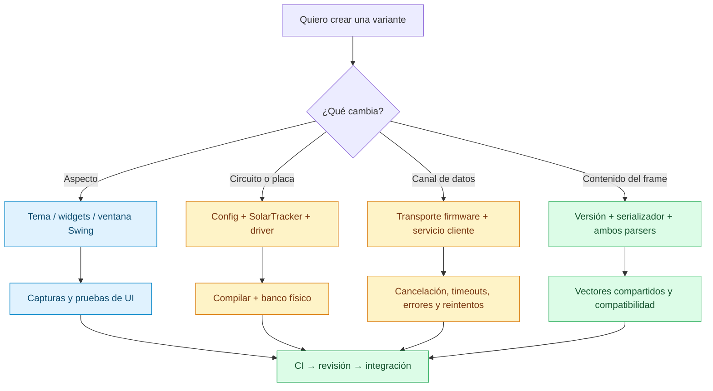

### Recetas de modificación

| Objetivo | Archivos / puntos de entrada | Qué conservar | Prueba mínima útil |
|---|---|---|---|
| Cambiar colores, fuentes o marca | Flutter `ui/theme.dart`, widgets e icono; Java `Main`/`MainTrackerFrame` | Lectura, estados, accesibilidad y acciones | Capturas con datos y dimensiones iguales; navegación/exportación |
| Cambiar pines o ajustar movimiento | `include/TheoJansenConfig.h`, `src/SolarTracker.cpp` | Límites físicos, orden de LDR y temporizadores compatibles | Build Uno, rangos de ángulo y ensayo físico |
| Cambiar la placa | `platformio.ini`, config, ADC en `SolarTracker.cpp`, transporte | Frame V2 y contrato de unidades | Firmware para nueva placa + vectores + medición real |
| Cambiar el plugin NFC móvil | `lib/services/nfc_service.dart`, `pubspec.yaml`, permisos nativos | Streams, selección de slots, comando pendiente, ACK y cierre | `nfc_service_test.dart` adaptado al nuevo plugin y pruebas en teléfono |
| Cambiar lector de escritorio | `NfcServiceManager.initializeReader` y APDU | `NfcEventListener`, liberación de tarjeta y EDT | `NfcServiceManagerTest` + lector real con driver |
| Añadir BLE, serial o red | Nuevo transporte firmware y nuevo servicio cliente | `RobotTelemetry`, parsers, gestión de sesión y mensajes de error | Vectores + desconexión/reconexión + cancelación |
| Añadir un sensor al frame | `TheoJansenTelemetry.*`, parsers Java/Dart, modelos, simuladores y vectores | Compatibilidad explícita con lectores existentes | Nueva versión de contrato; vectores válidos/ inválidos en tres lenguajes |
| Añadir almacenamiento persistente | Consumo del historial en dashboard Java/Flutter | Snapshot para exportación; límite de memoria; orden temporal | Reinicio, datos incompletos y fallo de escritura |
| Cambiar reportes | Exportación Java en `MainTrackerFrame`; Flutter `ReportService` | Esquema existente o migración documentada | Comparar campos JSON y escaping CSV |
| Publicar una variante móvil | IDs Android/iOS, iconos, firma, enlaces, DSN y política de versión | Identidad/firma original si se actualiza la misma app | Instalación/actualización y revisión de configuración de tu distribución |

**Ejemplo: otro transporte sin rediseñar el dashboard.**

1. Implementa `begin()` y `publish()` de `TelemetryTransport` para el nuevo hardware y conéctalo en `src/main.cpp`. La interfaz solo cubre publicación; los comandos entrantes necesitan su propio método y validación.
2. En Java, añade un servicio que entregue `RobotTelemetry` a `NfcEventListener`; adapta la conexión del servicio en `Main`/ventana. La ventana actual usa el tipo concreto `NfcServiceManager`, por lo que cambiar de transporte requiere modificar esa conexión.
3. En Flutter, implementa adquisición, errores y cierre mediante streams. Sustituye la instancia del servicio y sus listeners en `_DashboardScreenState`; el dashboard actual también crea servicios concretos.
4. Si transportas los mismos 12 bytes V2, reutiliza parser y vectores. Si cambia el formato, actualiza ambos clientes y el firmware juntos con una estrategia de compatibilidad.
5. Prueba interrupciones, datos inválidos y cierre de pantalla antes de usar hardware real.

**Ejemplo: una variante que funcione sin servicios externos.** El escaneo, la simulación y los reportes son locales. Para desactivar el envío a Sentry y la política remota al ejecutar Flutter:

```bash
cd heliostrand_app
flutter run --dart-define=SENTRY_DSN= --dart-define=VERSION_POLICY_URL=
```

Esto no garantiza por sí solo todos los recursos visuales offline: comprueba la disponibilidad de las fuentes y plugins en tu plataforma. Una variante distribuida debe revisar también identidad, privacidad y licencia. No reutilices las credenciales de firma de otra aplicación.

### Límites de reutilización actuales

- Hay separación de dominio, parser y transporte, pero no un sistema de plugins ni sustitución de componentes por archivo de configuración.
- Java concentra parte de la lógica de aplicación en `MainTrackerFrame`; extraer simulación o reportes puede ser útil cuando una variante lo necesite.
- Flutter usa servicios concretos creados en el estado del dashboard; inyectarlos es una evolución posible, no una capacidad implementada.
- Web, macOS, Linux, Windows e iOS necesitan validar plugins, permisos, compilación y hardware antes de prometer soporte equivalente a Android.
- No se ofrece autenticación criptográfica del tag, sincronización multiusuario ni confirmación de ejecución del comando por el robot.

## Desarrollo y validación

Requisitos de referencia: Flutter **3.47.2**, Dart compatible con `^3.13.2`, JDK **21**, Python 3, PlatformIO **6.1.19** y compilador C++ para pruebas nativas. Maven **3.9.9** se obtiene mediante el wrapper con comprobación SHA-256.

### Firmware

```bash
python3 tools/generate_golden_vectors_header.py
pio run -e uno
pio test -e native
pio check -e uno --skip-packages
c++ -std=c++17 -Wall -Wextra -Werror -Itest/nfc_host/stubs -Iinclude test/nfc_host/main.cpp src/NfcTransceiver.cpp src/TheoJansenTelemetry.cpp -o /tmp/nfc-host-tests
/tmp/nfc-host-tests
```

### Escritorio

```bash
cd AplicacionJava
./mvnw --batch-mode clean test package
java --add-modules java.smartcardio -jar target/AplicacionJava-1.2.0-jar-with-dependencies.jar
```

Para NFC se necesita un lector PC/SC compatible. El modo simulación permite comprobar el dashboard sin lector.

### Aplicación móvil

```bash
cd heliostrand_app
flutter pub get
flutter analyze
flutter test
flutter run
```

Se requiere un teléfono Android con NFC para verificar el transporte real. La simulación no requiere el lector. Los tests de transporte usan un canal simulado y no sustituyen una prueba física con PN532, tag y servos.

### Ciclo de desarrollo compartido

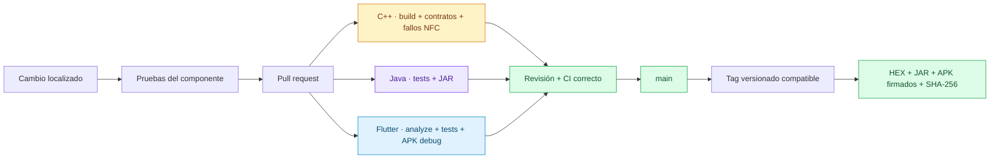

Un merge a `main` ejecuta CI, pero no crea automáticamente un tag ni una release. Las pruebas físicas de NFC, lectores y actuadores complementan las pruebas automatizadas.

## Distribución y tamaño

Android release ya utiliza R8, eliminación de recursos sin uso y reducción de iconos. La limpieza retira dependencias sin consumidores y recursos duplicados; borrar comentarios reduce el fuente, no necesariamente el binario.

```bash
flutter build apk --release
flutter build apk --release --split-per-abi
flutter build appbundle --release
```

| Artefacto | Uso |
|---|---|
| APK universal | Instalación directa compatible con las arquitecturas incluidas |
| APK `arm64-v8a` | Teléfonos ARM de 64 bits, sin bibliotecas de otras arquitecturas |
| APK `armeabi-v7a` | Dispositivos ARM de 32 bits |
| APK `x86_64` | Entornos x86 de 64 bits compatibles |
| Android App Bundle | Distribución por Google Play con selección por dispositivo |

La firma exige `android/key.properties` y el keystore local. No hay fallback a firma debug. No se deben regenerar las claves existentes al actualizar una aplicación publicada.

La release por tag valida que Maven y Flutter coincidan, construye firmware/JAR/APK y publica checksums SHA-256. Incluye el APK universal y variantes por ABI. [Releases disponibles](https://github.com/RamsesCB/heliostrand-nfc-core-cpp/releases).

## Configuración y seguridad

| Configuración | Propósito |
|---|---|
| `SENTRY_DSN` | Override mediante `--dart-define` del destino público de errores; vacío desactiva envío |
| `APP_ENV` | Entorno de Sentry, por defecto `production` |
| `VERSION_POLICY_URL` | Endpoint HTTPS opcional para el mínimo `versionCode` permitido |
| `android/key.properties` | Referencias y contraseñas de firma; archivo local ignorado |
| `.env` / `.env.*` | Ignorados; no se cargan automáticamente en Flutter |

`heliostrand-version.json` expresa un **entero de compilación**, no una versión semántica: `min_required_version_code: 2` conserva la política existente. Cambiarlo a `1.2.0` sería inválido. El servicio limita la respuesta a 4096 bytes y utiliza la última política válida si falla la red.

Los DSN públicos de Sentry permiten enviar eventos, no leer datos ni administrar la cuenta ([documentación oficial](https://github.com/getsentry/sentry-docs/blob/master/docs/concepts/key-terms/dsn-explainer.mdx)). No deben confundirse con tokens de acceso. Una clave privada expuesta debe revocarse antes de sanear el historial; reescribir Git no elimina copias, forks ni descargas anteriores.

## Versiones

Esta tabla recoge las versiones distintas encontradas en los manifiestos Java/Flutter y los tags existentes. El sufijo `+N` es el build number móvil; no representa una nueva versión del protocolo. El formato V2 se mantiene durante la serie 1.1/1.2. Las descargas disponibles se consultan en Releases.

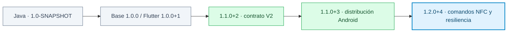

| Versión | Referencia | Cambios |
|---|---|---|
| **1.2.0+4** | [Revisión 1.2.0](https://github.com/RamsesCB/heliostrand-nfc-core-cpp/commit/38ce5ed39ee9058104a51985aa4000d9628cc340); Maven 1.2.0; sin tag v1.2.0 | Control de servos por NFC, tarjeta de estado expandible, corrección LDR y revisión de resiliencia |
| **1.1.0+3** | Commit `c2835c8` | Incremento de compilación para distribución Android |
| **1.1.0+2** | [Tag v1.1.0](https://github.com/RamsesCB/heliostrand-nfc-core-cpp/releases/tag/v1.1.0) · `2f62e0e` | Protocolo V2, slots NFC alternos, contratos compartidos y reducción de recursos |
| **1.0.0+1** | Commit `1130983` | Primera aplicación Flutter dentro del monorepositorio |
| **1.0-SNAPSHOT** | [Java inicial](https://github.com/RamsesCB/heliostrand-nfc-core-cpp/commit/d60d8fa) | Etapa de desarrollo Maven anterior a las versiones estables |
| **1.0.0** | [Tag v1.0.0](https://github.com/RamsesCB/heliostrand-nfc-core-cpp/releases/tag/v1.0.0) | Release histórica anterior a la remediación V2 |

Consulta el [historial](https://github.com/RamsesCB/heliostrand-nfc-core-cpp/commits) y los [tags](https://github.com/RamsesCB/heliostrand-nfc-core-cpp/tags) para el estado publicado. Un tag publicado no se mueve para sustituir su contenido.

## Catálogo documental

Todos los documentos de proyecto y recursos de modelado versionados se enlazan aquí. Se conserva el contenido de `DOCUMENTS.md` y `docs/`; sus referencias históricas pueden diferir del código 1.2.0. Para el comportamiento actual usa los diagramas de este README junto al código y sus pruebas.

### Gobierno, operación y entrega

| Documento | Para qué leerlo | Estado / alcance |
|---|---|---|
| [README.md](README.md) | Arquitectura visual, decisiones, componentes y guía de adaptación | Guía de entrada actual |
| [CONSTITUTION.md](CONSTITUTION.md) | Invariantes técnicos, seguridad y gobernanza | Actualizado para 1.2.0 |
| [RULES.md](RULES.md) | Reglas y validación de firmware, Java y Flutter | Actualizado para 1.2.0 |
| [CONTRIBUTING.md](CONTRIBUTING.md) | Flujo de contribución, pruebas y PR | Actualizado para 1.2.0 |
| [DOCUMENTS.md](DOCUMENTS.md) | Manual operativo y contexto técnico | Conservado; contiene referencias a 1.1.0 y lecturas antiguas |
| [LICENSE.md](LICENSE.md) | Condiciones de uso, modificación y atribución | HELS-AEL 1.0 |
| [QA_HANDOFF_V1.2.0.txt](QA_HANDOFF_V1.2.0.txt) | Dossier de entrega QA y antecedentes | Histórico; checksum del comando real es XOR, no suma |
| [README móvil](heliostrand_app/README.md) | Responsabilidades del cliente Flutter y build | Resumen del componente |
| [Privacidad](heliostrand_app/PRIVACY_POLICY.md) | Información de privacidad de la distribución | Revisar al crear una variante |
| [Checklist Play Store](heliostrand_app/PLAY_STORE_RELEASE_CHECKLIST.md) | Preparación de firma y publicación Android | No acredita publicación ni sustituye validación de release |

### Especificaciones y diseño conservado

| Documento / recurso | Contenido | Uso |
|---|---|---|
| [Protocolo V2](docs/protocol/telemetry-v2.md) | Contrato binario normativo | Consultar antes de modificar el frame |
| [Pinout](docs/hardware/pinout.md) | Cableado, alimentación y calibración | Montaje y adaptación del circuito |
| [Diseño minimalista: README](docs/design_minimalista/README.md) | Guía de la propuesta visual original | Histórico; rutas/TODO no describen necesariamente la estructura actual |
| [Guía de cambios visuales](docs/design_minimalista/GUIA_CAMBIOS.md) | Personalización de la propuesta de diseño | Referencia histórica |
| [Prompt maestro](docs/design_minimalista/PROMPT_MAESTRO.txt) | Brief de diseño original | Contexto, no especificación ejecutable |
| [APPNFC.drawio](docs/diagrams/APPNFC.drawio) | Modelo editable en diagrams.net | Diagrama histórico conservado |
| [APPNFC PDF](docs/diagrams/APPNFC.drawio.pdf) | Exportación del modelo | Consulta visual del modelo histórico |
| [Class_Diagram0.asta](docs/diagrams/Class_Diagram0.asta) | Modelo de clases Astah | Fuente histórica editable |
| [Diagrama_lector_NFC.asta](docs/diagrams/Diagrama_lector_NFC.asta) | Modelo del lector NFC | Fuente histórica editable |
| [NFC_2.asta](docs/diagrams/NFC_2.asta) | Modelo NFC adicional | Fuente histórica editable |

### Contratos ejecutables y notas de plataforma

| Recurso | Función |
|---|---|
| [Vectores JSON](test/vectors/golden_telemetry_vectors.json) · [generador](tools/generate_golden_vectors_header.py) | Casos compartidos de serialización y validación |
| [Pruebas C++](test/test_telemetry) · [fallos NFC](test/nfc_host) | Contrato y persistencia/comandos simulados |
| [Pruebas Java](AplicacionJava/src/test/java) · [pruebas Flutter](heliostrand_app/test) | Parsers, servicios, reportes y widgets |
| [include/README](include/README) · [lib/README](lib/README) · [test/README](test/README) | Notas de estructura generadas por PlatformIO |
| [LaunchImage README](heliostrand_app/ios/Runner/Assets.xcassets/LaunchImage.imageset/README.md) | Personalización del recurso de arranque iOS |
| [CI](.github/workflows/ci.yml) · [release](.github/workflows/release.yml) · [paquetes](.github/workflows/package.yml) | Validación, artefactos y publicación Maven |
| [Banner de arquitectura](assets/readme/architecture-banner.svg) | Ilustración vectorial editable de este README |

Los diagramas Mermaid son texto versionado dentro del README: pueden modificarse en el mismo PR que cambia una clase, un caso de uso o una dependencia. GitHub los renderiza; un visor Markdown sin Mermaid mostrará el bloque fuente. Los `.asta` requieren un visor compatible y no se regeneran con CI.

## Contribuir

1. Consulta la [Constitución](CONSTITUTION.md) y las [reglas técnicas](RULES.md).
2. Sigue la [guía de contribución](CONTRIBUTING.md) y ejecuta los controles del componente afectado.
3. Describe el fallo, el cambio, las pruebas y las limitaciones de hardware en el PR.

[Índice documental](DOCUMENTS.md) · [Privacidad](heliostrand_app/PRIVACY_POLICY.md) · [Licencia](LICENSE.md)

**Licencia:** HELS-AEL 1.0, Source-Available con atribución obligatoria; no es una licencia aprobada por la OSI.
