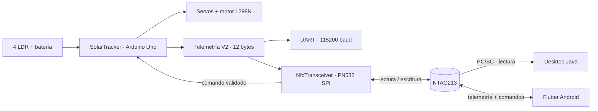
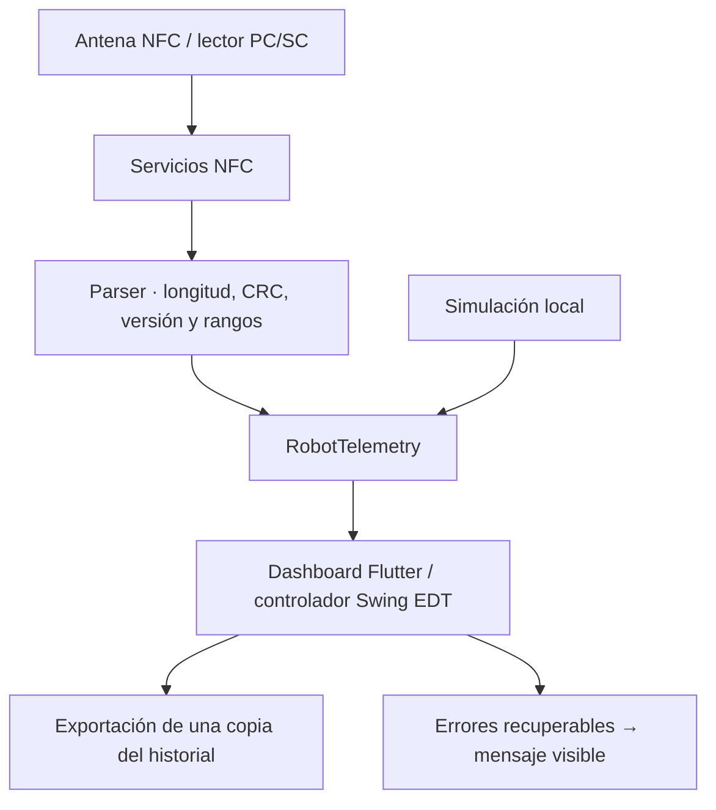
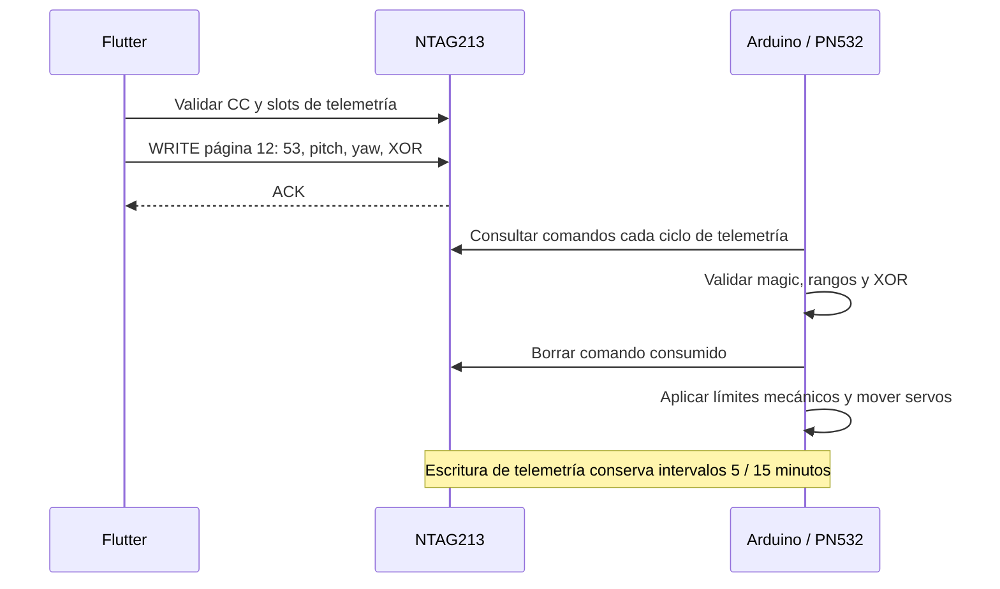

<div align="center">
  
  <h1>Heliostrand · Solar Tracker</h1>
  <p><strong>Seguimiento solar biaxial, robótica Theo Jansen y telemetría NFC.</strong></p>
  <p>Arduino Uno · Java 21 · Flutter · Protocolo V2</p>

[](https://github.com/RamsesCB/heliostrand-nfc-core-cpp/actions/workflows/ci.yml)
[](#versiones)
[](#contrato-de-datos)
[](LICENSE.md)

</div>

---

## Navegación

[Visión general](#visión-general) · [Arquitectura](#arquitectura) · [Datos](#contrato-de-datos) · [Hardware](#hardware) · [Desarrollo](#desarrollo-y-validación) · [Distribución](#distribución-y-tamaño) · [Versiones](#versiones) · [Contribuir](#contribuir)

## Visión general

Heliostrand conecta un robot con seguimiento solar de dos ejes a clientes que permiten consultar sus sensores, servos, motor y batería. El firmware produce telemetría binaria; un tag pasivo **NTAG213** permite intercambiarla con un teléfono o un lector de escritorio.

| Componente | Responsabilidad | Tecnologías |
|---|---|---|
| Firmware | Muestreo LDR y batería, seguimiento solar, motor, persistencia NFC | Arduino Uno / ATmega328P, PlatformIO, PN532 SPI |
| Aplicación móvil | Dashboard, comandos de servos, historial y exportación JSON/CSV | Flutter, Dart, `flutter_nfc_kit` |
| Escritorio | Lectura NFC, gráficas, simulación y exportación JSON | Java 21, Swing/FlatLaf, JFreeChart, PC/SC |
| Contratos | Verificación común de serialización y validación | Vectores JSON, Unity, JUnit, Flutter Test |

El dashboard móvil conserva su diseño claro, tipografía Inter y acentos ámbar/celeste. Android es la plataforma móvil validada por CI. iOS declara el permiso de uso NFC y el entitlement `TAG`; necesita una firma/provisioning con esa capacidad para probarse en dispositivo. Los directorios iOS, macOS, Linux, Windows y Web son bases de plataforma; su presencia no implica una release NFC validada para cada sistema.

## Arquitectura

### 1. Ecosistema y transportes



El PN532 es lector/escritor del tag. Los clientes leen el **NTAG213**, no directamente el PN532. UART es un transporte binario independiente; no existe un lector UART en el cliente Java actual.

### 2. Capas de las aplicaciones



- **Dominio y parser:** el mismo frame produce los mismos valores en C++, Java y Dart. El parser no depende de widgets.
- **Servicios:** NFC, simulación, exportación y política de versiones tienen responsabilidades separadas. Las sesiones NFC no se duplican al pulsar repetidamente.
- **Presentación:** Flutter consume streams; Java entrega eventos al EDT. La inicialización PC/SC y la escritura de reportes Java se ejecutan fuera de ese hilo.
- **Resiliencia:** errores de exportación, enlaces y lecturas se comunican al usuario. El historial mantiene hasta 500 muestras; el móvil muestra primero las cinco más recientes.

### 3. Comandos separados de la política de escritura



La consulta de comandos se realiza cada segundo cuando hay hardware disponible; no espera a la siguiente escritura de telemetría. El acuse de borrado debe tener éxito antes de entregar el comando. Un error de escritura conserva el comando móvil para reintento. La consigna ajusta los ángulos y el seguimiento automático continúa; no cambia a un modo manual persistente.

## Contrato de datos

| Canal | Formato | Validación |
|---|---|---|
| Telemetría | 12 bytes; batería `uint16` Big-Endian | V2, rangos físicos, CRC-8 `0x07`, inicial `0x00` |
| UART | `AA 55` + 12 bytes + `CR LF` | Flujo de máquina sin logs de texto |
| Slot A | Páginas 4–6 + commit en 7 | Magic `48 53`, generación y complemento |
| Slot B | Páginas 8–10 + commit en 11 | Generación modular, CRC y fallback al otro slot |
| Servos | Página 12: `53 pitch yaw checksum` | `checksum = 0x53 ^ pitch ^ yaw`; ángulos 0–180 |

La especificación detallada está en [telemetría V2](docs/protocol/telemetry-v2.md) y los [vectores compartidos](test/vectors/golden_telemetry_vectors.json). El checksum de comandos es **XOR**, aunque el dossier QA original lo describe como suma.

Cada actualización NFC invalida primero el commit del slot destino, escribe y verifica el payload y publica el nuevo commit al final. El otro slot permanece disponible. Tras la primera escritura, se exige un cambio significativo y al menos cinco minutos; sin cambios, el refresco ocurre a los quince minutos. CRC y secuencia no cuentan como cambios. CRC y UID no son mecanismos de autenticación criptográfica.

## Hardware

| Recurso | Pines / límites |
|---|---|
| LDR Norte, Sur, Oeste, Este | A0, A1, A2, A3 |
| Batería Li-ion 1S | A4 · divisor 20 kΩ / 20 kΩ + 100 nF |
| Motor L298N | D3 ENA · D5 IN1 · D6 IN2 |
| PN532 SPI | D4 CS · D11 MOSI · D12 MISO · D13 SCK |
| Servo Pitch | D9 · 15–165° |
| Servo Yaw | D10 · 10–170° |
| LED de estado | D7 |

Ver [pinout y calibración](docs/hardware/pinout.md). El firmware limita físicamente los ángulos recibidos; no se modifica la calibración para reducir tamaño.

## Mapa del repositorio

```text
include/                 Contratos y configuración de firmware
src/                     Control solar, serialización y transportes
AplicacionJava/
  src/main/java/         Dominio, parser, PC/SC y Swing
  src/test/java/         Contratos y regresiones de lector
heliostrand_app/
  lib/models/            Datos de telemetría
  lib/parser/            Decodificación V2
  lib/services/          NFC, simulación, reportes y actualización
  lib/ui/                Pantallas, widgets, tema y gestión de errores
  test/                  Contratos, servicios y widgets
  android/               Firma y empaquetado Android
  assets/icons/          Icono utilizado por el dashboard
test/vectors/            Fuente compartida de vectores
test/test_telemetry/     Pruebas nativas del protocolo
test/nfc_host/           PN532 simulado: comandos y fallos de escritura
tools/                   Generación de cabecera C++ para pruebas
.github/workflows/       CI, paquetes Maven y releases por tag
docs/                    Documentación técnica existente
```

## Desarrollo y validación

Requisitos de referencia: Flutter **3.47.2**, Dart compatible con `^3.13.2`, JDK **21**, Python 3, PlatformIO **6.1.19** y compilador C++ para pruebas nativas. Maven **3.9.9** se obtiene mediante el wrapper con comprobación SHA-256.

### Firmware

```bash
python3 tools/generate_golden_vectors_header.py
pio run -e uno
pio test -e native
pio check -e uno --skip-packages
c++ -std=c++17 -Wall -Wextra -Werror -Itest/nfc_host/stubs -Iinclude test/nfc_host/main.cpp src/NfcTransceiver.cpp src/TheoJansenTelemetry.cpp -o /tmp/nfc-host-tests
/tmp/nfc-host-tests
```

### Escritorio

```bash
cd AplicacionJava
./mvnw --batch-mode clean test package
java --add-modules java.smartcardio -jar target/AplicacionJava-1.2.0-jar-with-dependencies.jar
```

Para NFC se necesita un lector PC/SC compatible. El modo simulación permite comprobar el dashboard sin lector.

### Aplicación móvil

```bash
cd heliostrand_app
flutter pub get
flutter analyze
flutter test
flutter run
```

Se requiere un teléfono Android con NFC para verificar el transporte real. La simulación no requiere el lector. Los tests de transporte usan un canal simulado y no sustituyen una prueba física con PN532, tag y servos.

## Distribución y tamaño

Android release ya utiliza R8, eliminación de recursos sin uso y reducción de iconos. La limpieza retira dependencias sin consumidores y recursos duplicados; borrar comentarios reduce el fuente, no necesariamente el binario.

```bash
flutter build apk --release
flutter build apk --release --split-per-abi
flutter build appbundle --release
```

| Artefacto | Uso |
|---|---|
| APK universal | Instalación directa compatible con las arquitecturas incluidas |
| APK `arm64-v8a` | Teléfonos ARM de 64 bits, sin bibliotecas de otras arquitecturas |
| APK `armeabi-v7a` | Dispositivos ARM de 32 bits |
| APK `x86_64` | Entornos x86 de 64 bits compatibles |
| Android App Bundle | Distribución por Google Play con selección por dispositivo |

La firma exige `android/key.properties` y el keystore local. No hay fallback a firma debug. No se deben regenerar las claves existentes al actualizar una aplicación publicada.

La release por tag valida que Maven y Flutter coincidan, construye firmware/JAR/APK y publica checksums SHA-256. Incluye el APK universal y variantes por ABI. [Releases disponibles](https://github.com/RamsesCB/heliostrand-nfc-core-cpp/releases).

## Configuración y seguridad

| Configuración | Propósito |
|---|---|
| `SENTRY_DSN` | Override mediante `--dart-define` del destino público de errores; vacío desactiva envío |
| `APP_ENV` | Entorno de Sentry, por defecto `production` |
| `VERSION_POLICY_URL` | Endpoint HTTPS opcional para el mínimo `versionCode` permitido |
| `android/key.properties` | Referencias y contraseñas de firma; archivo local ignorado |
| `.env` / `.env.*` | Ignorados; no se cargan automáticamente en Flutter |

`heliostrand-version.json` expresa un **entero de compilación**, no una versión semántica: `min_required_version_code: 2` conserva la política existente. Cambiarlo a `1.2.0` sería inválido. El servicio limita la respuesta a 4096 bytes y utiliza la última política válida si falla la red.

Los DSN públicos de Sentry permiten enviar eventos, no leer datos ni administrar la cuenta ([documentación oficial](https://github.com/getsentry/sentry-docs/blob/master/docs/concepts/key-terms/dsn-explainer.mdx)). No deben confundirse con tokens de acceso. Una clave privada expuesta debe revocarse antes de sanear el historial; reescribir Git no elimina copias, forks ni descargas anteriores.

## Versiones

Esta tabla distingue versiones presentes en el código de tags publicados y verificados en GitHub. Las descargas disponibles se consultan en Releases.

| Versión | Referencia | Cambios |
|---|---|---|
| **1.2.0+4** | [Rama 1.2.0](https://github.com/RamsesCB/heliostrand-nfc-core-cpp/tree/feature/v1.2.0-ui-fixes); Maven 1.2.0 | Control de servos por NFC, tarjeta de estado expandible, corrección LDR y revisión de resiliencia |
| **1.1.0+3** | Commit `c2835c8` | Incremento de compilación para distribución Android |
| **1.1.0+2** | [Tag v1.1.0](https://github.com/RamsesCB/heliostrand-nfc-core-cpp/releases/tag/v1.1.0) · `2f62e0e` | Protocolo V2, slots NFC alternos, contratos compartidos y reducción de recursos |
| **1.0.0+1** | Commit `1130983` | Primera aplicación Flutter dentro del monorepositorio |
| **1.0.0** | [Tag v1.0.0](https://github.com/RamsesCB/heliostrand-nfc-core-cpp/releases/tag/v1.0.0) | Release histórica anterior a la remediación V2 |

Consulta el [historial](https://github.com/RamsesCB/heliostrand-nfc-core-cpp/commits) y los [tags](https://github.com/RamsesCB/heliostrand-nfc-core-cpp/tags) para el estado publicado. Un tag publicado no se mueve para sustituir su contenido.

## Contribuir

1. Consulta la [Constitución](CONSTITUTION.md) y las [reglas técnicas](RULES.md).
2. Sigue la [guía de contribución](CONTRIBUTING.md) y ejecuta los controles del componente afectado.
3. Describe el fallo, el cambio, las pruebas y las limitaciones de hardware en el PR.

[Índice documental](DOCUMENTS.md) · [Privacidad](heliostrand_app/PRIVACY_POLICY.md) · [Licencia](LICENSE.md)

**Licencia:** HELS-AEL 1.0, Source-Available con atribución obligatoria; no es una licencia aprobada por la OSI.
